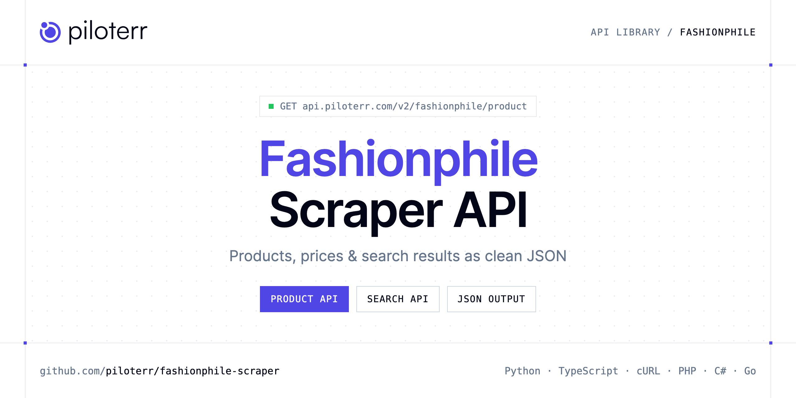

<p align="center">
  <a href="https://www.piloterr.com"></a>
</p>

# Fashionphile Scraper API

[](https://discord.gg/CFj3ph8aHU) [](https://app.piloterr.com) [](https://app.piloterr.com/openapi) [](LICENSE)

The **Piloterr Fashionphile Scraper API** lets you extract public data from Fashionphile as **clean, structured JSON** — no proxies, headless browsers or HTML parsing to maintain. Endpoints available in production:

- **Fashionphile Product API** — Load one Fashionphile product from a handle or a product URL.
- **Fashionphile Search API** — Search Fashionphile by keywords, a search URL, a collection URL, or a products.json URL.

Use it for price monitoring, assortment tracking, competitor analysis, product research or catalog enrichment.

| Endpoint | Path | Credits | What you get |
|---|---|---|---|
| [Fashionphile Product API](#fashionphile-product-api) | `/v2/fashionphile/product` | 1 | Load one Fashionphile product from a handle or a product URL. Keywords and search URLs belong on the search endpoint. |
| [Fashionphile Search API](#fashionphile-search-api) | `/v2/fashionphile/search` | 1 | Search Fashionphile by keywords, a search URL, a collection URL, or a products.json URL. A product handle or product URL belongs on the product endpoint. |

## Table of contents

- [How it works](#how-it-works)
- [Fashionphile Product API](#fashionphile-product-api)
- [Fashionphile Search API](#fashionphile-search-api)
- [Code examples in other languages](#code-examples-in-other-languages)
- [Practical use cases](#practical-use-cases)
- [Why Piloterr?](#why-piloterr)
- [FAQ](#faq)
- [Related scrapers](#related-scrapers)
- [Support](#support)

## How it works

1. **Create a free Piloterr account** and copy your API key from the [dashboard](https://app.piloterr.com).
2. **Send a `GET` (or `POST`) request** to `https://api.piloterr.com/v2/...` with the header `x-api-key: YOUR_API_KEY`.
3. **Receive structured JSON** — Piloterr handles rendering, proxies, retries and parsing.

```bash
export PILOTERR_API_KEY="your-api-key"
pip install requests        # Python
# TypeScript: Node.js 18+ (native fetch), run with `npx tsx file.ts`
```

> Every endpoint accepts both `GET` (query string) and `POST` (JSON body with the same fields).

## Fashionphile Product API

Load one Fashionphile product from a handle or a product URL. Keywords and search URLs belong on the search endpoint.

`GET | POST https://api.piloterr.com/v2/fashionphile/product` · **1 credit per request** · [Full reference](https://app.piloterr.com/openapi)

### Request parameters

| Parameter | Type | Required | Description |
|---|---|---|---|
| `query` | string | ✅ | Product handle or a fashionphile.com product URL. The request reads products/{handle}.js and returns one flat product. price is the USD amount and price_display is that amount rebuilt as a dollar string. |
| `return_page_source` | boolean | — | Default false. true replaces the product object with result, the raw Shopify JSON text. |

### Python example

```python
import json
import os
import requests

response = requests.get(
    "https://api.piloterr.com/v2/fashionphile/product",
    headers={"x-api-key": os.environ["PILOTERR_API_KEY"]},
    params={
        "query": "celine-supple-shiny-lambskin-little-new-luggage-black-1978804",
    },
    timeout=120,
)
response.raise_for_status()
data = response.json()

print(json.dumps(data, indent=2, ensure_ascii=False)[:2000])
```

### TypeScript example

```typescript
type FashionphileProduct = {
  id?: number;
  sku?: string;
  url?: string;
  tags?: string[];
  price?: number;
  title?: string;
  handle?: string;
  images?: {
    url?: string;
    width?: number;
    height?: number;
  }[];
  vendor?: string;
  barcode?: string;
  currency?: string;
  available?: boolean;
  created_at?: string;
  description?: string;
  product_type?: string;
  published_at?: string;
  price_display?: string;
};

const params = new URLSearchParams({
  "query": "celine-supple-shiny-lambskin-little-new-luggage-black-1978804",
});

const response = await fetch(`https://api.piloterr.com/v2/fashionphile/product?${params}`, {
  headers: { "x-api-key": process.env.PILOTERR_API_KEY! },
});
if (!response.ok) throw new Error(`Piloterr error ${response.status}: ${await response.text()}`);

const data = (await response.json()) as FashionphileProduct;

console.log(JSON.stringify(data, null, 2).slice(0, 2000));
```

<details>
<summary><b>POST variant</b></summary>

```http
POST https://api.piloterr.com/v2/fashionphile/product
x-api-key: YOUR_API_KEY
Content-Type: application/json

{"query": "celine-supple-shiny-lambskin-little-new-luggage-black-1978804"}
```
</details>

### Output example

Example response from the API reference, abridged — real values depend on the page you scrape.

```json
{
  "id": 16185286066479,
  "sku": "1978804",
  "url": "https://www.fashionphile.com/products/celine-supple-shiny-lambskin-little-new-luggage-black-1978804",
  "tags": [
    "amazon-market-template",
    "Editor's Picks"
  ],
  "price": 2095,
  "title": "Supple Shiny Lambskin Little New Luggage Black",
  "handle": "celine-supple-shiny-lambskin-little-new-luggage-black-1978804",
  "images": [
    {
      "url": "https://cdn.shopify.com/s/files/1/0894/3186/7695/files/4d8ef446e96a2ae61bde572ba8d24150.jpg?v=1790192118",
      "width": 1500,
      "height": 1500
    }
  ],
  "vendor": "Celine",
  "barcode": "000019788043",
  "currency": "USD",
  "available": true,
  "created_at": "2026-09-23T12:35:13-07:00",
  "description": "This is an authentic CELINE Supple Shiny Lambskin Little New Luggage in Black. This chic tote offers a new take on the iconic luggage han…",
  "product_type": "Bags",
  "published_at": "2026-09-23T12:35:17-07:00",
  "price_display": "$2,095.00"
}
```

### Response fields

| Field | Type | Description |
|---|---|---|
| `id` | integer |  |
| `sku` | string |  |
| `url` | string |  |
| `tags` | string[] |  |
| `price` | integer |  |
| `title` | string |  |
| `handle` | string |  |
| `images[]` | object[] |  |
| `images[].url` | string |  |
| `images[].width` | integer |  |
| `images[].height` | integer |  |
| `vendor` | string |  |
| `barcode` | string |  |
| `currency` | string |  |
| `available` | boolean |  |
| `created_at` | string |  |
| `description` | string |  |
| `product_type` | string |  |
| `published_at` | string |  |
| `price_display` | string |  |

## Fashionphile Search API

Search Fashionphile by keywords, a search URL, a collection URL, or a products.json URL. A product handle or product URL belongs on the product endpoint.

`GET | POST https://api.piloterr.com/v2/fashionphile/search` · **1 credit per request** · [Full reference](https://app.piloterr.com/openapi)

### Request parameters

| Parameter | Type | Required | Description |
|---|---|---|---|
| `query` | string | ✅ | Keywords, a Fashionphile search URL, a collection URL, or a products.json URL. Empty returns 400. |
| `page` | number | — | Page number starting at 1. Omit it for page 1. |
| `return_page_source` | boolean | — | Default false. true replaces results and pagination with result, the raw Shopify JSON text. |

### Python example

```python
import json
import os
import requests

response = requests.get(
    "https://api.piloterr.com/v2/fashionphile/search",
    headers={"x-api-key": os.environ["PILOTERR_API_KEY"]},
    params={
        "query": "celine",
    },
    timeout=120,
)
response.raise_for_status()
data = response.json()

print(json.dumps(data, indent=2, ensure_ascii=False)[:2000])
```

### TypeScript example

```typescript
type FashionphileSearch = {
  results?: {
    id?: number;
    url?: string;
    tags?: string[];
    image?: string;
    price?: number;
    title?: string;
    handle?: string;
    vendor?: string;
    currency?: string;
    available?: boolean;
    product_type?: string;
    price_display?: string;
  }[];
  pagination?: {
    next?: unknown;
    page?: number;
    per_page?: number;
    total_pages?: unknown;
    total_results?: unknown;
  };
};

const params = new URLSearchParams({
  "query": "celine",
});

const response = await fetch(`https://api.piloterr.com/v2/fashionphile/search?${params}`, {
  headers: { "x-api-key": process.env.PILOTERR_API_KEY! },
});
if (!response.ok) throw new Error(`Piloterr error ${response.status}: ${await response.text()}`);

const data = (await response.json()) as FashionphileSearch;

console.log(JSON.stringify(data, null, 2).slice(0, 2000));
```

<details>
<summary><b>POST variant</b></summary>

```http
POST https://api.piloterr.com/v2/fashionphile/search
x-api-key: YOUR_API_KEY
Content-Type: application/json

{"query": "celine"}
```
</details>

### Output example

Example response from the API reference, abridged — real values depend on the page you scrape.

```json
{
  "results": [
    {
      "id": 16185286066479,
      "url": "https://www.fashionphile.com/products/celine-supple-shiny-lambskin-little-new-luggage-black-1978804",
      "tags": [
        "amazon-market-template",
        "Editor's Picks"
      ],
      "image": "https://cdn.shopify.com/s/files/1/0894/3186/7695/files/4d8ef446e96a2ae61bde572ba8d24150.jpg?v=1790192118",
      "price": 2095,
      "title": "Supple Shiny Lambskin Little New Luggage Black",
      "handle": "celine-supple-shiny-lambskin-little-new-luggage-black-1978804",
      "vendor": "Celine",
      "currency": "USD",
      "available": true,
      "product_type": "Bags",
      "price_display": "$2,095.00"
    }
  ],
  "pagination": {
    "next": null,
    "page": 1,
    "per_page": 10,
    "total_pages": null,
    "total_results": null
  }
}
```

### Response fields

| Field | Type | Description |
|---|---|---|
| `results[]` | object[] |  |
| `results[].id` | integer |  |
| `results[].url` | string |  |
| `results[].tags` | string[] |  |
| `results[].image` | string |  |
| `results[].price` | integer |  |
| `results[].title` | string |  |
| `results[].handle` | string |  |
| `results[].vendor` | string |  |
| `results[].currency` | string |  |
| `results[].available` | boolean |  |
| `results[].product_type` | string |  |
| `results[].price_display` | string |  |
| `pagination` | object |  |
| `pagination.next` | object |  |
| `pagination.page` | integer |  |
| `pagination.per_page` | integer |  |
| `pagination.total_pages` | object |  |
| `pagination.total_results` | object |  |

## Code examples in other languages

Ready-to-run examples live in the [`examples/`](examples) folder. Each one reads your key from the `PILOTERR_API_KEY` environment variable.

| Language | Product | Search |
|---|---|---|
| cURL (Bash) | [`product`](examples/curl/product.sh) | [`search`](examples/curl/search.sh) |
| PHP | [`product`](examples/php/product.php) | [`search`](examples/php/search.php) |
| C# | [`product`](examples/csharp/Product.cs) | [`search`](examples/csharp/Search.cs) |
| Go | [`product`](examples/go/product.go) | [`search`](examples/go/search.go) |
| Java | [`product`](examples/java/ProductExample.java) | [`search`](examples/java/SearchExample.java) |
| Ruby | [`product`](examples/ruby/product.rb) | [`search`](examples/ruby/search.rb) |
| Node.js | [`product`](examples/nodejs/product.mjs) | [`search`](examples/nodejs/search.mjs) |

## Practical use cases

- **Price monitoring** — Track prices, promotions and availability over time to react to competitors.
- **Assortment & catalog tracking** — Follow new products, delisted items and category changes.
- **Competitor analysis** — Benchmark ranges, brands and positioning across retailers.
- **Product research** — Spot best-sellers and trends from search results.
- **Catalog enrichment** — Pull titles, images and attributes into your PIM or marketplace listings.

## Why Piloterr?

- **No infrastructure** — no proxies, headless browsers or CAPTCHA solving to run yourself.
- **Structured JSON** — stable, documented fields instead of brittle HTML selectors.
- **Pay per request** — transparent credit cost per endpoint, failed requests are retried for you.
- **One API key, hundreds of sources** — Fashionphile plus many other e-commerce, search and company data endpoints in the [Piloterr library](https://www.piloterr.com/library).
- **Any language** — plain HTTPS + JSON, with examples for Python, TypeScript, cURL, PHP, C#, Go, Java, Ruby and Node.js.

## FAQ

### Is it legal to scrape Fashionphile?

Collecting publicly available data is generally allowed in many jurisdictions, but rules depend on your country, the data you collect and how you use it. Avoid personal data unless you have a lawful basis, respect the website's terms where they apply, and get legal advice for your specific use case. This is not legal advice.

### Do I need proxies or a headless browser?

No. Piloterr handles rendering, proxy rotation and retries on its side. You only send an HTTPS request with your `x-api-key` header and receive JSON.

### How much does a request cost?

Credits per call: `/v2/fashionphile/product` **1**, `/v2/fashionphile/search` **1**. See the [Piloterr website](https://www.piloterr.com) for plans.

### What data does the Fashionphile API return?

Each endpoint returns structured JSON: **Fashionphile Product** — `id`, `sku`, `url`, `tags`, `price`, `title`; **Fashionphile Search** — `results[]`, `results[].id`, `results[].url`, `results[].tags`, `results[].image`, `results[].price`.

### How do I paginate Fashionphile results?

Use the `page` parameter and keep requesting while the response indicates more results.

### Can I get the raw HTML instead of JSON?

Yes. Set `return_page_source=true` and the response becomes `{"result": "..."}` with the page source.

### Which languages are supported?

Any language that can make an HTTP request. This README shows Python and TypeScript; the [`examples/`](examples) folder contains cURL, PHP, C#, Go, Java, Ruby and Node.js.

## Related scrapers

- [About You Scraper API](https://github.com/piloterr/aboutyou-scraper)
- [Action Scraper API](https://github.com/piloterr/action-scraper)
- [Aldi Scraper API](https://github.com/piloterr/aldi-scraper)
- [Alibaba Scraper API](https://github.com/piloterr/alibaba-scraper)
- [AliExpress Scraper API](https://github.com/piloterr/aliexpress-scraper)
- [Allegro Scraper API](https://github.com/piloterr/allegro-scraper)
- [All Piloterr scrapers on GitHub](https://github.com/piloterr)

## Support

- 💬 Join the [Piloterr Discord](https://discord.gg/CFj3ph8aHU) to ask questions and share what you build.
- 📚 Browse the [API reference (OpenAPI)](https://app.piloterr.com/openapi) and the [Piloterr library](https://www.piloterr.com/library).
- 🔑 [Get your API key](https://app.piloterr.com).

---

<p align="center">
  <a href="https://www.piloterr.com">
    <picture>
      <source media="(prefers-color-scheme: dark)" srcset="images/logo-dark.svg">
      
    </picture>
  </a>
  <br>
  <sub>Built by <a href="https://www.piloterr.com">Piloterr</a> — web scraping APIs for e-commerce, search, real estate and more, one API key.</sub>
</p>

<sub>Fashionphile is a trademark of its respective owner. This repository is not affiliated with or endorsed by Fashionphile. Examples are released under the MIT license.</sub>
